# VoltRelay — Network Diagnostic Analysis Report

**Prepared for:** VoltRelay operations and customer-experience leadership
**Data window:** 1 January 2024 – 30 June 2025 · 3,877,013 swap attempts · 152 stations · 6 cities
**Companion artefacts:** `VoltRelay_Analysis.ipynb` (analysis) · `dashboard/VoltRelay_Dashboard.html` (dashboard) · `reports/VIDEO_SCRIPT.md` (3-minute presentation)

---

## 1. The answer first

VoltRelay's service problem is **not growth, and not software**. Success rate holds at **95.66% ± 0.1pp** for eleven of eighteen months while volume compounds **+191%**. It breaks only in summer:

| Period | Attempts | Success rate |
|---|---|---|
| Apr–Jun 2024 | 426,984 | **90.15%** |
| Apr–Jun 2025 | 990,575 | **91.69%** |
| All other months | 2,459,454 | **95.66%** |

That is a **seasonal thermal-capacity failure**, and it is concentrated in a specific asset cohort: Gen1 cabinets in Jaipur and Delhi, whose success rate collapses to **79–88%** every April–June while the rest of the network holds 95.5%. The thermal effect survives station fixed effects (**OR 3.07–3.82** within the same cabinet), but hot hours are only 12.5% of attempts, so the recoverable pool is **₹5.8 lakh/year**, not the full seasonal gap.

The margin problem is separate and is **not** pricing. Contribution per swap is healthy at **₹26.70**; the erosion comes from **23 under-utilised new stations** losing **₹2.37 lakh/month** and **one partner contract** leaking **₹4.90 lakh/month** in discount.

---

## 2. Business problem, restated

VoltRelay operates a battery-swap network for 2W/3W commercial riders — mostly food-delivery and e-commerce fleets — across six Indian cities. Three questions matter to leadership:

1. **How is the network actually performing?** — a defensible KPI baseline, not a headline average.
2. **What is associated with failed swaps, rider churn and margin erosion — and which of those are primary drivers versus secondary contributors?** — the analytical core; requires holding factors constant, because every plausible driver in this dataset is correlated with the others.
3. **What should be prioritised?** — sized in rupees and swaps, not adjectives.

The dataset has no label and no counterfactual, so the deliverable is an **evidence-weighted argument**, not a causal proof. Where the data cannot support a causal claim (the pricing pilot), this report says so explicitly rather than hiding it.

---

## 3. Analytical approach

**Data understanding.** Eight related tables, one grain each: swap attempts (3.88M), station-hourly telemetry (1.49M), riders (20k), batteries (6.5k), tickets (44k), stations (152), city-day context (3.3k), fleet partners (12). All nine foreign-key relationships resolve with **zero orphans** — unusual, and it means the failures observed are operational, not data-entry noise.

**Cleaning.** A six-step ledger records the row impact of every decision: typed load, duplicate removal on `event_id`, impossible SoC/SoH > 100% nulled rather than deleted, negative `km_since_last_swap` nulled, rider city spellings normalised (21 raw spellings → 6 cities), and tickets clipped to the swap window. Three **traps** were identified and neutralised (Section 4.1).

**Analysis.** KPI baselining → mechanism-by-mechanism driver testing → a cell-aggregated weighted binomial GLM to separate primary from secondary → rider-month panel for churn → unit-economics decomposition for margin → anomaly tests (binomial z-scores with multiplicity awareness) → two quasi-experiments (difference-in-differences with bootstrap CIs and an explicit parallel-trends test).

**Tools.** Python (pandas 2/3, numpy, matplotlib, scipy) end-to-end; the notebook re-executes top-to-bottom in ~3 minutes and regenerates every figure and every number in this report from `reports/key_findings.json`. A self-contained HTML dashboard is generated from the same outputs. SQL/Power BI were not needed — the analysis is too join- and model-heavy for a BI layer to carry, and the dashboard covers the presentation requirement.

---

## 4. Key insights

### 4.1 Three traps that would have produced wrong recommendations

**(a) The "healthy battery" illusion.** Failed swaps have no `battery_out_id` because no pack was dispensed. Any "success rate by out-pack SOH" therefore returns **100% for every SOH band**. That is survivorship, not safety. Battery effects were measured on the *returned* pack instead.

**(b) Templated ticket text.** 44,000 tickets contain just **89 distinct comment strings**, each mapping to exactly one category. Text mining would only rediscover the category column, so the analysis uses categories and says so — no fabricated NLP.

**(c) CSAT is missing not-at-random.** CSAT exists only for `resolved` tickets: 15,129 of 44,000. Unresolved and duplicate tickets have none. Mean CSAT is therefore a statement about resolved tickets only, not about service quality.

### 4.2 Q1 — Network performance: compounding growth, flat reliability, seasonal collapse

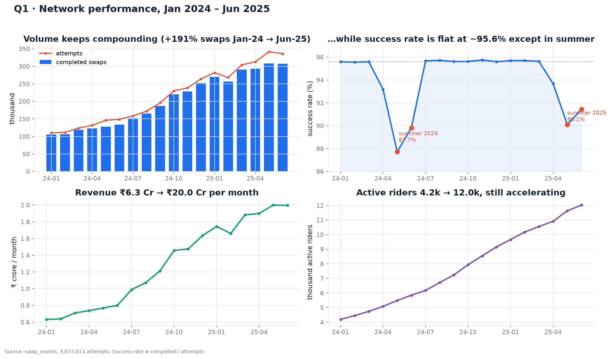

Swaps grew from 105,490 to 307,259 per month (**+191%**); active riders from 4,186 to 12,030; monthly revenue from ₹63.2 lakh to ₹2.00 crore (₹23.31 crore in total). Success rate stayed at 95.6% throughout — with two exceptions, both pre-monsoon summers. Twenty-two of the network's eighteen months carry the same reliability; the two that don't explain most of the 231,204 failed attempts.

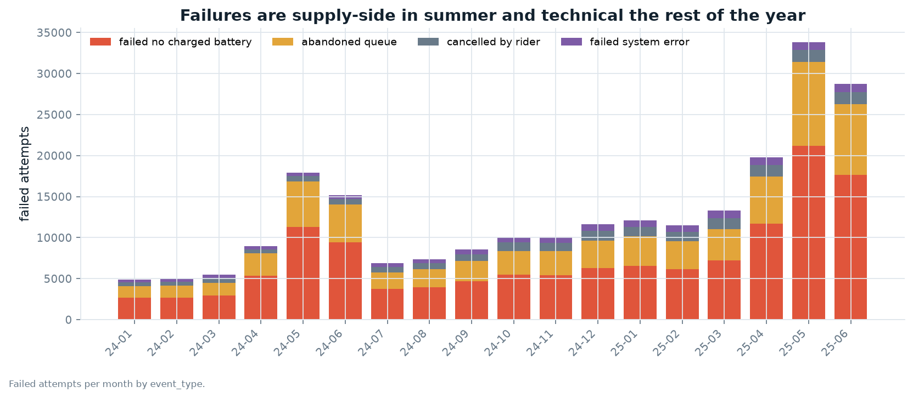

The failure taxonomy matters more than the failure count. **58.1%** of failures are `failed_no_charged_battery`, **29.6%** are `abandoned_queue`, **7.2%** are `cancelled_by_rider`, and only **5.0%** are `failed_system_error`. System errors sit at **0.27–0.32% of attempts in every single month** — a flat technical floor. Everything that moves is supply-side and moves seasonally. This alone rules out "fix the app" as the priority.

### 4.3 Q2 — What breaks a swap: heat is primary, hardware is secondary, stock is a symptom

**Marginal evidence.** Heat-alert days (190,246 attempts) run **85.07%** success against **94.50%** otherwise. Cabinet temperature tracks it: **95.41%** below 25 °C → **88.09%** above 50 °C, while mean recharge time stretches from **74 to 139 minutes**. Zero-stock hours look catastrophic too: **88.46%** vs **94.61%** at 11+ charged packs.

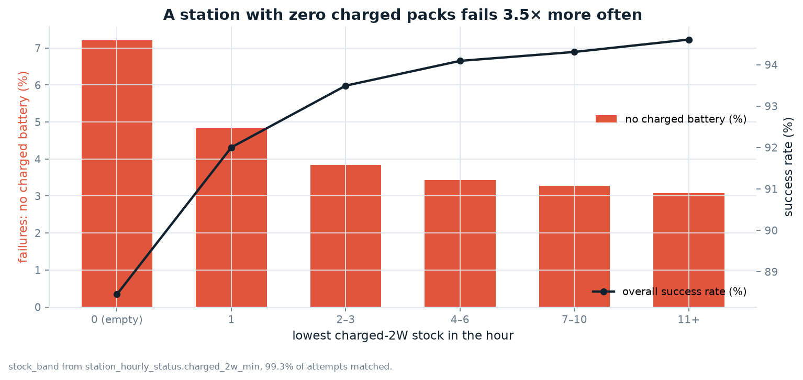

**Controlled evidence.** Marginal rates confound each other — hot days are busy days, Gen1 cabinets sit in the oldest cities. A cell-aggregated weighted binomial GLM (IRLS over 3.88M attempts, 32 parameters) separates them:

| Term | Model 1 (time+city) | Model 2 (+hardware, heat, battery) | Model 3 (+charged stock) |
|---|---|---|---|
| Heat-alert day | **2.74** [2.70–2.78] | **1.65** [1.62–1.68] | **1.65** [1.62–1.68] |
| Cabinet 40–45 °C | — | **3.08** [3.02–3.13] | 3.07 [3.02–3.13] |
| Cabinet 45–50 °C | — | **3.29** [3.21–3.37] | 3.23 [3.15–3.31] |
| Charged stock = 0 | — | — | **1.09** [1.05–1.12] |
| Gen1 charger | — | **1.33** [1.32–1.35] | 1.33 [1.31–1.34] |
| Gen3 charger | — | **0.68** [0.67–0.70] | 0.69 [0.67–0.70] |
| Poor connectivity | — | 1.02 [1.00–1.03] | 1.02 [1.00–1.03] |
| Returned pack SOH <65% | — | **1.20** [1.17–1.23] | 1.20 [1.17–1.23] |

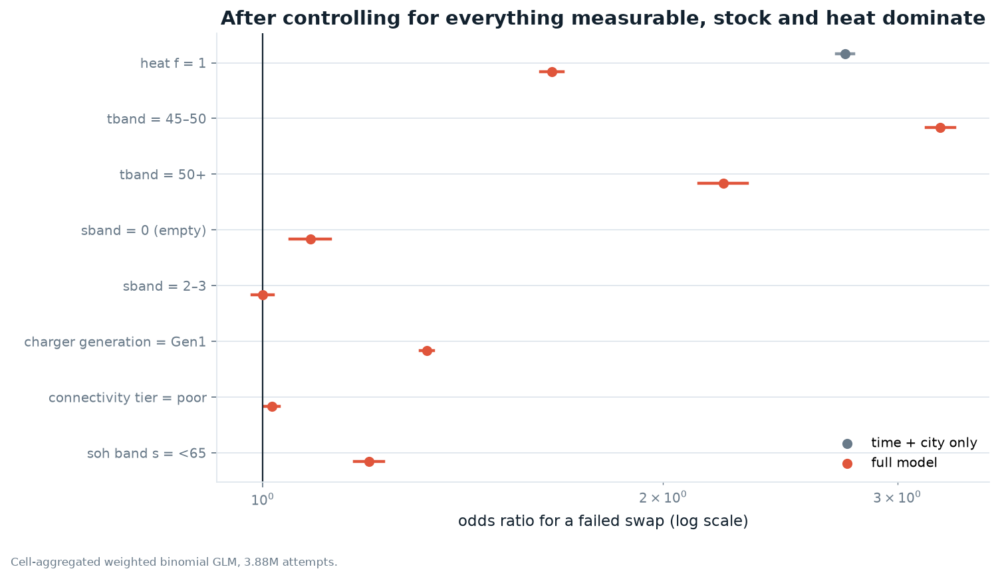

**Station fixed effects.** Because failures cluster inside stations, the model was re-fitted with **152 station dummies**, so every station is compared only to itself. The thermal effect gets *stronger*, not weaker: cabinet 40–45 °C **OR 3.07 [3.02–3.12]**, 45–50 °C **OR 3.82 [3.74–3.90]**. It is not a station-quality artefact.

Three conclusions follow, and one of them contradicts the obvious reading of the data:

- **Cabinet heat is the primary driver** (OR 3.08–3.29). Heat-day risk halves from 2.74 to 1.65 once cabinet temperature enters the model, which is exactly what a thermal mechanism implies.
- **Charged stock is a *secondary* contributor, not the cause.** Its marginal 6-point effect collapses to **OR 1.09** under controls. Empty cabinets are largely a *symptom* of hot hours and peak demand, so a pure "add more packs" fix would under-deliver.
- **Heat is not mediated by stock.** Adding stock to the model leaves the heat OR unchanged (1.65 → 1.65). Hot cabinets fail riders even when packs are on the shelf — thermal derating and heat-related faults, not just empty shelves.

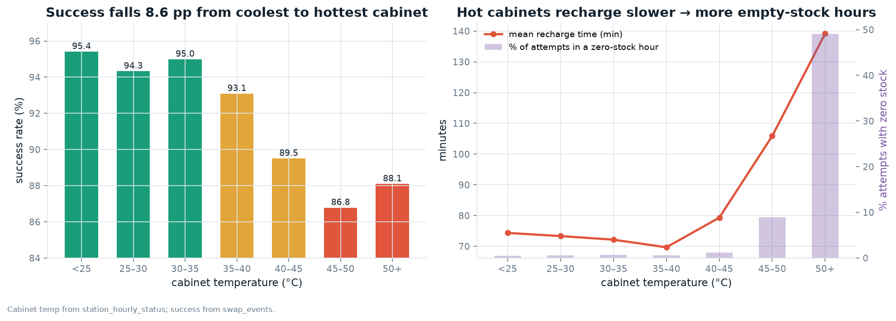

**Hardware.** Gen1 cabinets run **92.77%** vs Gen2's **95.16%** (OR 1.33), and Gen3 is better still (OR 0.68). The ten worst stations by binomial z-score are *all* Gen1 and *all* in Jaipur and Delhi. Their monthly series is the most striking pattern in the dataset: **95.5–96% in normal months, 79–88% every April–June** — an annual average of 91.3% that hides a predictable annual failure.

City medians range from **91.74%** (Jaipur) to **95.56%** (Mumbai) — Jaipur is ~3.8pp below the best city, and its shortfall is almost entirely the same Gen1 cohort.

**Battery condition.** Reinforcing the survivorship trap, the informative variable is the returned pack: SOH below 65% carries **OR 1.20**, 65–70% carries 1.07. Modest — but it points at a specific supplier.

### 4.4 The Kyron cohort — a supply-risk anomaly with a P&L consequence

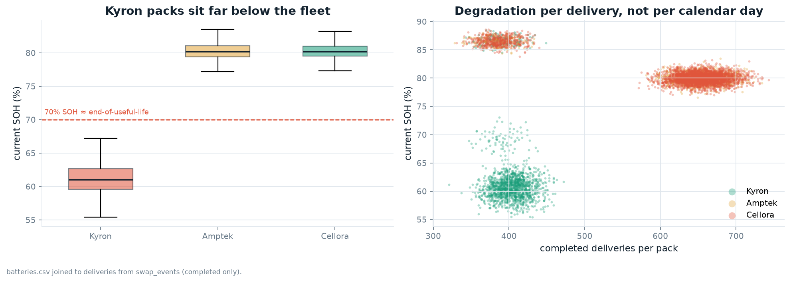

| Supplier | Packs | Median deliveries | Median SOH | SOH lost per 100 deliveries |
|---|---|---|---|---|
| Amptek | 1,307 | 648 | 80.2% | 2.93 |
| Cellora | 3,555 | 649 | 80.2% | 2.93 |
| **Kyron** | **1,638** | **401** | **61.0%** | **9.53** |

Kyron packs degrade **3.25× faster per delivery** than the other two suppliers on *fewer* deliveries. The obvious objection — that Kyron packs are simply older — **fails**: Kyron packs are *younger* (8.2 vs 12.1 months) and less used (401 vs 649 deliveries), and regressing SOH on deliveries, age, pack type and supplier still puts a **−8.66pp** penalty on Kyron (t = −58.7). The supplier effect is real and larger than the raw comparison suggests. They are 25.2% of the fleet, **all 1,438 packs retired** from the fleet are Kyron, and every single retirement is dated **15 June 2025** — a bulk write-off, not attrition.

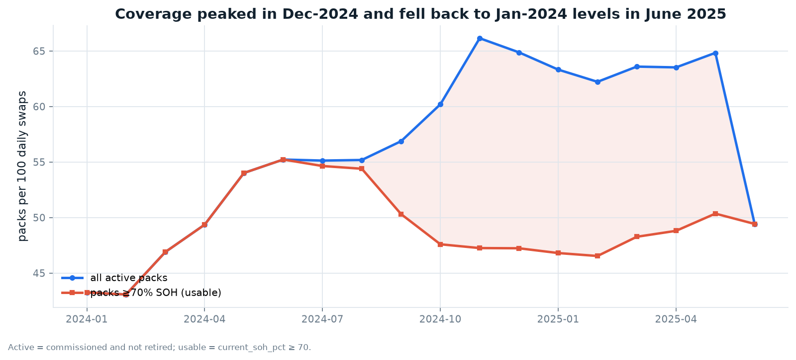

The consequence is visible in coverage: packs per 100 daily swaps peaked at **66.2** in November 2024, and the June write-off took active packs from **6,439 to 5,062 (−21.4% in one day)**, returning coverage to **49.4** — January-2024 levels — just as daily demand hit its all-time high of 10,242 swaps.

### 4.5 Q3 — Churn: the obvious hypothesis fails until it is stratified

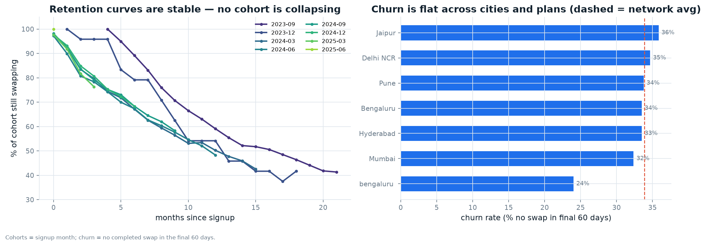

Baseline churn is **33.9%** (no swap in the final 60 days); month-12 cohort retention is **58.8%** and stable across cohorts. Plan type (33.3–34.0%), signup channel, vehicle class and partner status move churn by ≤1pp. City varies 11.8pp, which is a coverage story, not a service story. **None of the rider-attribute levers explains churn.**

The naive reliability test is worse than useless — it points the wrong way:

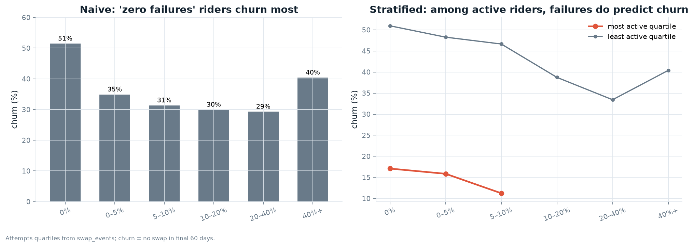

Riders with **zero** failed attempts churn at **51.4%**, the highest of any bucket. Riders with a 10–20% failure rate churn at 29.9%. Taken at face value this says "failures retain riders", which is nonsense: "zero failures" is dominated by riders who barely used the service and left. **Activity level, not reliability, was doing the work.**

The correct test conditions on being active: a rider-month panel (116,907 observations across 17,405 riders), measuring each month's failure rate against whether the rider returned within two months.

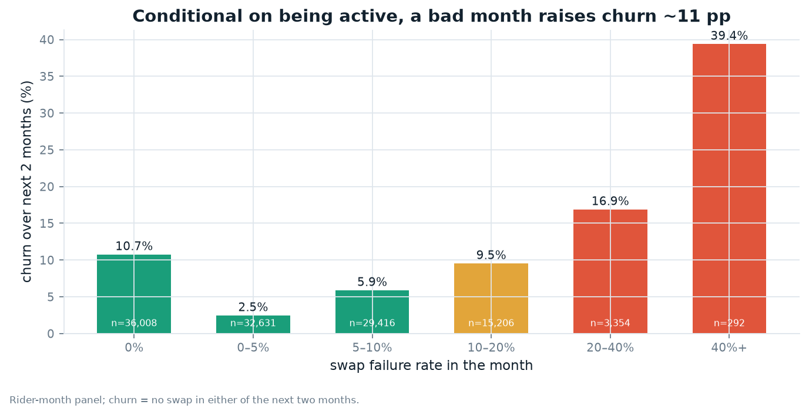

| Failure rate that month | 2-month churn |
|---|---|
| 0–5% | **2.45%** |
| 5–10% | 5.87% |
| 10–20% | 9.53% |
| 20–40% | 16.88% |
| 40%+ | **39.38%** |

A monotonic gradient, **2.5% → 39.4%**. Summarised as a contrast: high-failure months (≥10%) churn at **11.3%** versus **6.5%** below that, a **+4.8pp** penalty (rider-clustered bootstrap 95% CI **+4.4 to +5.1pp**) worth roughly **900 rider-months** of retention. The result is stable under 30-, 60- and 90-day churn definitions. Failures do drive churn — but the effect is a 5-point shove on a 34% base, not the dominant force. **Reliability is a retention problem, not *the* retention problem.**

### 4.6 Q4 — Margin: the problem is the cost base, not the price

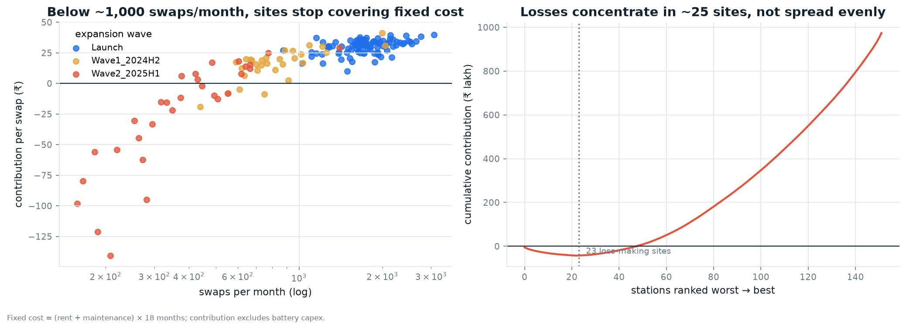

| Line | ₹ per swap |
|---|---|
| List price | 68.60 |
| Less discounts | −5.82 |
| **= Net revenue** | **63.94** |
| Less energy cost | −19.50 |
| **= Gross margin** | **44.45** |
| Less fixed site cost | −17.74 |
| **= Contribution** | **26.70** |

Gross margin is **44.45 per swap**, or ₹16.20 crore over the window. The damage is concentrated:

- **23 of 152 stations have negative contribution**, losing **₹2.37 lakh/month**.
- Every one of the ten worst is a **Wave2_2025H1** site: **374 swaps/month**, fixed cost **₹61.29/swap**, contribution **−₹12.19/swap**. Launch-wave sites do **+₹31.11** on 1,716 swaps/month and ₹12.77 of fixed cost. This is an **asset-utilisation ramp problem**, not a pricing problem.
- Mumbai has the best success rate (95.56%) and the worst contribution (₹17.34/swap median) — reliability and profitability are not the same map.

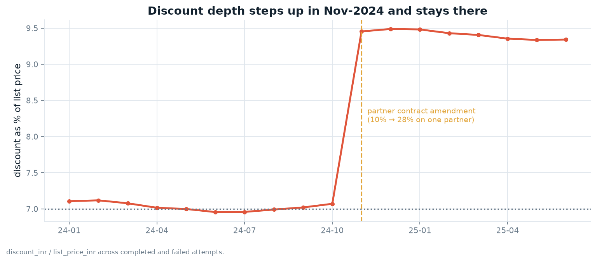

Discount depth steps from **7.03% to 9.41%** in November 2024 and never recovers. It is **one contract**, not a price war: **ZipDrop, amended 12% → 28%**. Excess discount versus the prior norm is **₹39.17 lakh over eight months — ₹4.90 lakh/month**.

### 4.7 Q5 — Anomalies worth flagging separately

| Anomaly | Scale | Reading |
|---|---|---|
| Jaipur + Delhi Gen1 stations | 8 stations, 81.7% of Jaipur attempts | Structural: 79–88% every Apr–Jun |
| Kyron pack cohort | 1,638 packs (25.2% of fleet) | 3.25× faster degradation; all 1,438 retirements |
| 15 June 2025 write-off | −1,437 active packs in one day | Fleet capacity event, not attrition |
| Heat-alert days | 190,246 attempts, 85.07% | Primary driver |
| Offline-batch sync | 591,114 attempts, 15.2% | 45% of attempts at fair/poor-connectivity sites — failures may be under-recorded there |
| Telemetry missing/partial | 46,371 station-hours (3.1%) | Blind spots concentrate in poor-connectivity sites |
| Full-hour outages | 308 station-hours of 1.49M | Negligible |
| Firmware | 61 vs 91 stations | **Not** a rollout: firmware never changes in the event log. A cross-sectional artefact; `stations.csv` update dates have no counterpart in events |

**What did *not* matter — reported because it is useful.** Rain, public holidays, festivals and e-commerce sale days show no degradation (sale days actually look *better* at 95.55% vs 94.01%, because they cluster in the cool Sep–Nov months). Ruling these out is as valuable as ruling them in.

### 4.8 Two quasi-experiments, with their assumptions checked

**Pricing pilot (peak/off-peak tariffs from October 2024, 56 of 152 stations).** Peak hours are 06–08, 12–17 and 19–22.

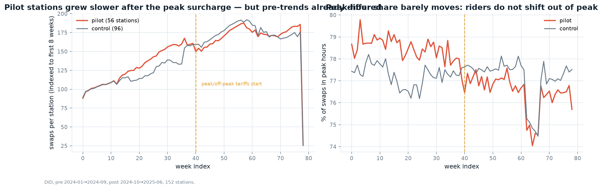

The parallel-trends test **fails**: pilot stations grew **+36.9%** in the pre-period versus **+25.8%** for control. A level DiD is therefore biased, so the headline is the log-scale DiD (ratio of ratios) with a station-level bootstrap: **−8.22% [−13.5%, −2.5%]**. Peak-hour share moved only **−1.9pp**. The defensible reading: **peak surcharges are associated with lower volume and do not move riders out of peak hours** — riders on delivery shifts are captive. The pilot should be revisited, and the next iteration should test package pricing rather than time-of-day pricing.

**Competitor entry (10 stations from 15 January 2025).** Log DiD **−3.05% [−12.6%, +5.8%]** — the interval spans zero and churn does not rise. **No measurable volume loss** from a competitor opening within 1.5 km. VoltRelay's problem is internal capacity, not competition.

### 4.9 A self-review: what I got wrong the first time

Three claims were corrected by testing them rather than defending them.

**(a) The thermal prize was overstated by 3×.** The first estimate credited the entire summer gap to heat — but summer also carries demand growth, so that conflates season with temperature. Restricting to the **within-station** contrast (cool hours versus >40 °C hours at the same cabinet) gives a **5.8pp** gap over **481,106** hot-hour attempts, and hot hours are only **12.5%** of attempts. At a realistic 70% capture that is **19,533 swaps (₹5.8 lakh/year)**, not ₹18.6 lakh. The mechanism is real and statistically strong; the *recoverable pool* is smaller than the raw seasonal gap implies.

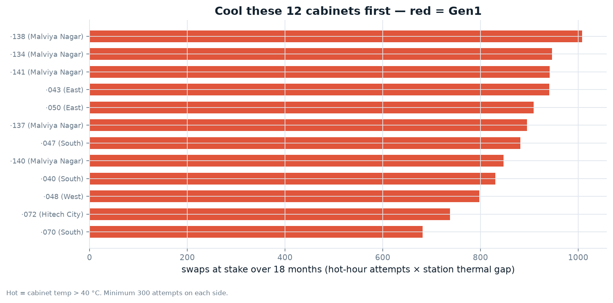

**(b) Which cabinets** — this turns the recommendation into a work order. Twelve stations each carry **10–11pp** of thermal gap, every one of them Gen1, all in Jaipur and Delhi (Maliya Nagar, DEL-East, DEL-Noida). The top target, STN-JAI-138, has 8,971 hot-hour attempts at 82.1% success against 93.4% in cool hours.

**(c) A units error is a real error.** The priority table initially reported the thermal figure as an 18-month total labelled per month, which would have overstated it 18×. It is now derived from whether an initiative was sized over the window, not matched by its title.

Two things a critical reader can still challenge, and should:
- The driver model gives controlled association. Only a cooling pilot will establish causation.
- The pricing pilot's DiD fails parallel trends; its estimate is reported with that caveat rather than dropped.

---

## 5. Business findings

1. **Reliability is structurally seasonal, and the 94.0% headline understates the risk.** The network runs two distinct regimes: 95.7% for ten months, 90–92% for two. Annual averages hide a failure that is *predictable* — which is what makes it fixable.
2. **The binding constraint is thermal, not inventory.** Heat and cabinet temperature dominate every other factor once controls are applied; charged-stock availability, the intuitive culprit, is a symptom worth OR 1.09.
3. **The failure is concentrated in an addressable asset cohort** — Gen1 cabinets at Jaipur and Delhi sites — plus a supplier cohort (Kyron) that degrades 3.25× faster and was written off in a single day.
4. **Churn is mildly reliability-sensitive and strongly habit-sensitive.** A bad month raises 2-month churn from 2.5% to 11.3% (and 39.4% at extreme failure rates) — real, but smaller than the 5-point effect the naive analysis implies.
5. **Margin erosion is an asset-utilisation and contract-discipline problem.** 23 new sites carry fixed cost 4.8× the launch sites' per swap; one contract amendment leaks ₹4.90 lakh/month.
6. **Pricing power is weak in peak hours and competition is not yet biting.** Both are good news for the capacity plan and bad news for a price-led recovery.

**Primary versus secondary drivers**

| Driver | Role | Evidence |
|---|---|---|
| Cabinet heat / summer thermal capacity | **Primary** | OR 3.07–3.82 within station; heat OR 2.74 → 1.65 with temp controlled |
| Gen1 charger hardware | **Primary (cohort-specific)** | OR 1.33; all 10 worst stations; 79–88% each summer |
| Kyron pack degradation | **Primary (supply)** | 9.53 vs 2.93 SOH pts/100 deliveries; 25% of fleet; 21.4% of packs removed in a day |
| Charged-stock availability | **Secondary / symptom** | OR 1.09 after controls; no mediation of heat |
| Returned-pack SOH < 65% | Secondary | OR 1.20 |
| Peak-hour pricing | Secondary (revenue) | −8.2% volume, −1.9pp peak share |
| Connectivity tier | **Not a driver** | OR 1.02 |
| Rain, holidays, festivals, competitor entry | **Not a driver** | No degradation; competitor DiD spans zero |

---

## 6. Recommendations

Sized from the observed effects, annualised, and sequenced. Impact is an *association-based* estimate, deliberately conservative.

| # | Action | Swaps recovered | Gross margin / yr | Owner | Success metric |
|---|---|---|---|---|---|
| 1 | **Re-tier partner discounts**; cap the amended contract at its previous 12% until volume commitments justify otherwise | — | **₹58.8 L** | Commercial | Discount % of list back ≤7.5% |
| 2 | **Fix or exit the 23 loss-making sites**: rent renegotiation, host change, relocation, or exit | — | **₹28.4 L** | Network planning | Contribution/swap > 0 at each site |
| 3 | **Replace Gen1 cabinets** at the 12 highest-gap Jaipur/Delhi sites with Gen2/Gen3 | 43,549 | **₹12.9 L** | Hardware | Those stations ≥95% in Apr–Jun |
| 4 | **Virtual queue with wait-time guarantee and pack hold** to convert abandonment | 34,266 | **₹10.2 L** | Product | Abandonment <1.5% of attempts |
| 5 | **Cool the 12 cabinets** with the largest thermal gap: shade, active cooling, charge throttling | 19,533 | **₹5.8 L** | Operations / hardware | Summer success ≥94%; charge time ≤90 min |
| 6 | **Minimum charged-pack floor** per cabinet in peak hours | 3,323 | **₹1.0 L** | Operations | Zero-stock hours <1% |
| 7 | **Re-bid the Kyron contract**; replace the 1,438 written-off packs; add an SOH-warranty clause | capacity & supply risk | — | Procurement | SOH loss ≤3 pts/100 deliveries |

**Total identified: ≈₹1.17 crore/year** of gross margin against ~₹10.8 crore of annual gross margin — about **11%** — before the Kyron replacement, which is a capacity-risk play rather than a margin one.

Note the ordering change from the first version of this analysis: **thermal cooling falls from first to fifth** once it is sized honestly, and the **Gen1 retrofit becomes the largest reliability lever**. That reordering is the most useful output of the robustness work, because it changes where the first rupee goes.

**Sequence matters.** Items 2, 4 and 5 are the *service* fix and must land before next April; item 1 and 3 are *self-funding* and can start immediately; items 6 and 7 are cheap complements that raise the return on both.

---

## 7. Limitations

- **Observational data; association, not proof.** The driver model and the panel give well-controlled associations. The thermal story is mechanistically coherent (recharge time rises 87% across the temperature range) but a cooling pilot would be needed to confirm it causally.
- **The thermal sizing is deliberately conservative**: it uses the within-station cool-vs-hot gap and assumes 70% capture. The mechanism is strong; the prize is modest.
- **The pricing DiD violates parallel trends** and is reported with that caveat; its interval is wide.
- **Exposure overlap is partial.** Heat days coincide with peak demand; the model absorbs hour, station and month, but unmeasured confounders (e.g. rider mix per hour) remain.
- **Failure *timing* is not observable.** `attempt_seq` is identically 1 for all 3.88M rows, so retry chains can't be reconstructed and the true rider-level cost of a failed swap is understated.
- **No cost data** for battery capex, support handling or rider acquisition, so margin is contribution-based, not a full P&L.
- **Billing attribution is unreliable**: `payment_mode` is `partner_invoice` for every row, including independent pay-as-you-go riders. Revenue is therefore taken from `amount_charged_inr`, not from payment routing.

---

## 8. Reproducibility

```
python -m pip install pandas numpy matplotlib scipy jupytext
jupyter nbconvert --to notebook --execute VoltRelay_Analysis.ipynb
python scripts/build_dashboard.py            # regenerates dashboard/VoltRelay_Dashboard.html
```

The notebook writes `reports/key_findings.json`; this report and the dashboard both read from it, so the numbers in all three cannot drift apart.
